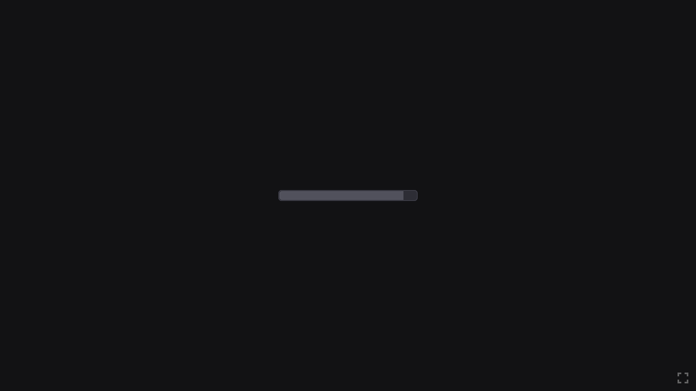
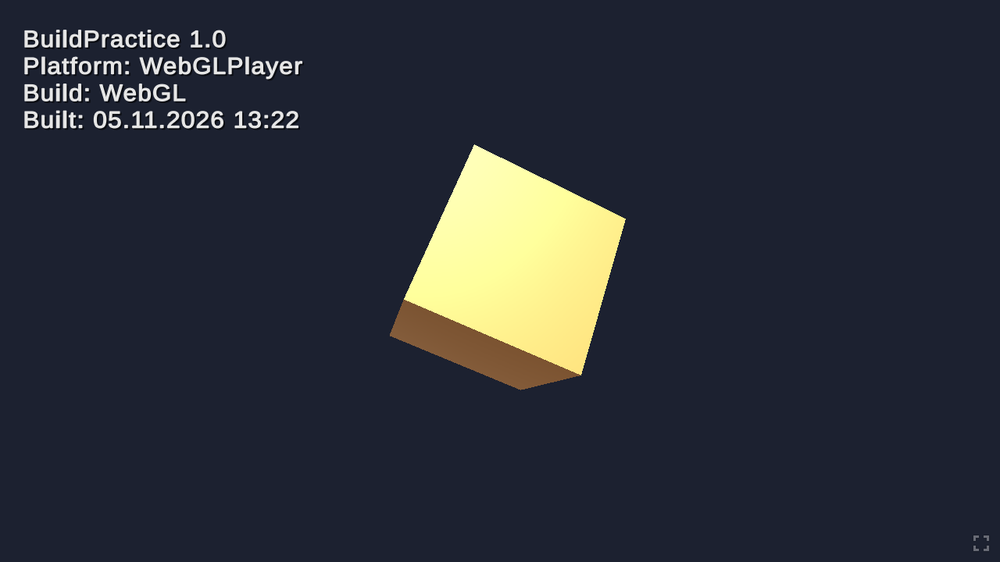
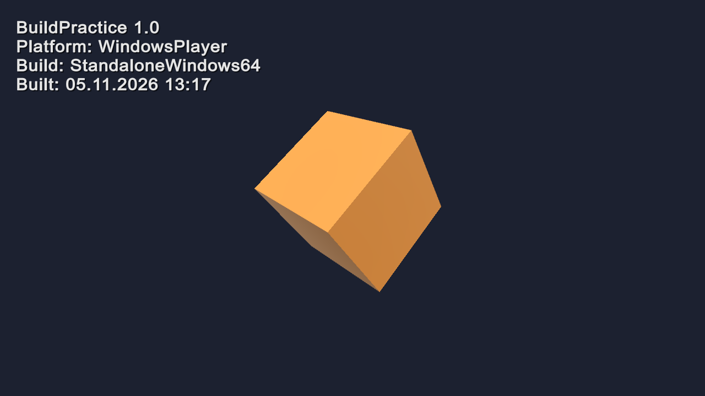

# Практика: автоматическая сборка Unity-проекта

Unity **6000.3.8f1**, Built-in Render Pipeline. Демо-сцена `Assets/Scenes/Main.unity`: вращающийся куб и подпись с платформой
и временем сборки. По подписи видно, что запущен именно получившийся билд.

- **Билды:** [Releases → v1.0](https://github.com/OCAVIT/unity-build-practice/releases/tag/v1.0):
  `BuildPractice-Windows.zip` (ПК), `BuildPractice.apk` (Android), `BuildPractice-WebGL.zip` (WebGL).
- **WebGL-билд онлайн, с кастомным шаблоном:** https://ocavit.github.io/unity-build-practice/

## Задание 1. Скрипт автоматической сборки

Скрипт: [`Assets/Editor/BuildScript.cs`](Assets/Editor/BuildScript.cs).

| Пункт меню | Что делает | Куда кладёт |
|---|---|---|
| **Build → Build All** | билд под ПК, затем под Android | `Builds/Windows/BuildPractice.exe`, `Builds/Android/BuildPractice.apk` |
| Build → Build PC (Windows) | только ПК (Windows x64) | `Builds/Windows/` |
| Build → Build Android | только Android (APK, IL2CPP, ARM64) | `Builds/Android/` |
| Build → Build WebGL (custom template) | WebGL с кастомным шаблоном (задание 2) | `Builds/WebGL/` |

Как работает:
- собирает включённые сцены из списка сборки (File → Build Profiles → Scene List) через `BuildPipeline.BuildPlayer`;
- перед каждой сборкой записывает платформу и время в `Assets/Resources/BuildInfo.txt`, билд показывает их на экране;
- после сборок возвращает в редакторе платформу, которая была выбрана;
- итог (путь, размер, время каждой сборки) пишет в консоль и показывает в окне. При ошибке сборка останавливается.

Те же методы запускаются без открытия редактора, из командной строки ([`build.bat`](build.bat)):

```bat
build.bat            :: Build All (ПК + Android)
build.bat Windows
build.bat Android
build.bat WebGL
```

`build.bat` берёт Unity той же версии из папки Unity Hub. Путь к другому редактору задаётся переменной окружения:
`set UNITY_EXE=...\Editor\Unity.exe`. Код выхода: 0, если всё собрано, иначе 1. Лог пишется в `Builds/build-<цель>.log`.

## Задание 2. WebGL с кастомным шаблоном

1. **Скачан шаблон.** Взят *Modern WebGL Template* от Andtech Studios
   ([github.com/andtechstudios/modern-webgl-template](https://github.com/andtechstudios/modern-webgl-template), лицензия BSD-3).
   Скачанный релиз v1.1.0 лежит в [`ThirdParty/modern.unitypackage`](ThirdParty), рядом лицензия.
2. **Подключён.** Пакет импортирован (`Unity -importPackage ThirdParty/modern.unitypackage`), шаблон лежит в
   [`Assets/WebGLTemplates/Modern`](Assets/WebGLTemplates/Modern).
3. **Выбран в настройках.** Project Settings → Player → WebGL → Resolution and Presentation → WebGL Template = **Modern**
   (в `ProjectSettings/ProjectSettings.asset`: `webGLTemplate: PROJECT:Modern`). Скрипт сборки тоже выставляет его перед WebGL-сборкой.
   Сжатие выключено (Publishing Settings → Compression Format = Disabled), чтобы билд открывался с любого статического хостинга.
4. **Собран и проверен.** Build → Build WebGL (custom template) → `Builds/WebGL`. После сборки скрипт проверяет, что
   `Builds/WebGL/index.html` собран из шаблона Modern: в нём есть функция шаблона `rebuildFullscreenGUI`. Если её нет,
   сборка считается проваленной.

Чем страница отличается от стандартного шаблона Unity: тёмный фон на всё окно (`#121214`), своя полоса загрузки,
кнопка полного экрана в правом нижнем углу, своя иконка вкладки. Нет логотипа Unity и подвала с названием игры.

## Проверка билдов

| WebGL: загрузка со страницей шаблона Modern | WebGL: билд запущен |
|---|---|
|  |  |

| ПК (Windows): билд запущен | Android |
|---|---|
|  | `BuildPractice.apk`: пакет `com.ktshki.buildpractice` 1.0, Android 7.1+, arm64-v8a, подписан debug-ключом (ставится напрямую) |

Скриншот Windows-билда снят самим билдом: `BuildPractice.exe -screenshot shot.png` сохраняет кадр через 2 секунды и закрывается.
Подпись в углу показывает платформу и время сборки, записанное скриптом сборки.

Время сборок на этом проекте: ПК около 10 с (повторная сборка быстрее), Android (IL2CPP) 3,5 мин, WebGL 1,5–3 мин.
